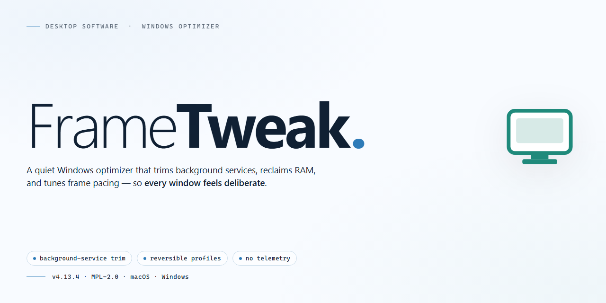

# FrameTweak: Performance Optimization & Debloat Tool for Windows 11

### 📦 PowerShell Install Button

  

---

FrameTweak is a comprehensive Windows optimization utility built to elevate gaming performance, increase frame rates, and eliminate system lag through a unified desktop interface. The application combines real-time hardware monitoring, evidence-based gaming diagnostics, and a curated debloat engine that removes unnecessary Store apps and background processes without touching security or system-critical components. Every tweak follows a transparent apply-verify-rollback pipeline with per-change backups, giving users full control over startup entries, registry settings, power plans, and input or visual preferences. Designed for Windows 10 and 11, FrameTweak emphasizes measurable results over inflated claims, reporting only what it can verify on the host machine.

## 📋 System Requirements

- **OS:** Windows 10 / 11
- **Shell:** PowerShell 5.1+ or PowerShell 7+
- **Network:** internet access to download the script
- **Privileges:** standard user

## Features

FrameTweak provides a modular optimization suite covering the most impactful areas of Windows performance and clutter. Each capability is built around a single shared change engine: settings are read, backed up, applied, re-read for verification, and rolled back automatically if verification fails. No change occurs without prior analysis and explicit approval.

- **Live System Dashboard:** Real-time CPU, memory, and disk utilization gauges alongside hardware and OS metadata, active power plan, Game Mode state, and startup entry counts. A plain-text export produces a before/after system snapshot suitable for troubleshooting or record-keeping. Values that cannot be read are reported as unavailable rather than estimated.

- **Performance Monitoring:** Continuously sampled CPU, memory, and disk charts with a ranked view of top memory consumers. Sampling is scoped to the visible monitoring view to avoid background overhead.

- **Gaming Diagnostics:** A short measured scan of CPU, memory, disk activity, top processes, display resolution and refresh rate, and available GPU telemetry. Findings are tied to observed evidence and avoid speculative bottleneck claims. Configurable performance profiles support validated import and export, and a history view enables before/after comparison across sessions.

- **Startup Management:** Enumerates Run-key and Startup-folder entries with their current status. Entries can be enabled or disabled through the same mechanism Task Manager uses, with each toggle backed up, verified, and reversible. No startup entries are deleted.

- **Application Debloat:** Detects installed Store applications and offers removal from a curated allow-list of optional consumer apps. Security, Store, gaming, and system components are explicitly blocked from removal. A single confirmation enumerates exactly what will be removed, and each removal is verified afterward.

- **Targeted Tweaks:** A catalog of individually applied, reversible tweaks organized into gaming, input, visual, and privacy groups. Each entry documents its purpose, expected effect, drawbacks, privilege requirements, reversibility, and current state. A bulk undo restores all applied tweaks with a full confirmation listing. All tweaks operate on current-user settings and require no administrator rights.

- **Disk Cleanup:** A fixed set of temp and cache locations — user temp files, crash dumps, error reports, and shader caches — analyzed before any removal. Shader caches are excluded by default due to first-launch rebuild stutter. Recent files and locked files are skipped, symlinks are never followed, and protected directories are refused. Cleanup reports measured bytes reclaimed.

- **Audit Logging and Preferences:** A local log viewer records every action taken, and monitoring interval and window geometry persist between sessions.

All subprocess execution is centralized through a single controlled interface with argument lists, hidden windows, and timeouts. Imported profiles are validated as data and never executed. No security features — Defender, Windows Update, firewall, drivers, or recovery — are modified. The application operates fully local with no account requirement and no telemetry.

## How It Works

FrameTweak operates on a single, unified change engine that governs every modification it makes to the operating system. Each action follows the same deterministic pipeline: the current state is read, the affected values are backed up to a local store, the change is applied, the state is re-read to verify the result, and any failure triggers an automatic rollback before the operation is logged. If a backup cannot be written, no change is attempted. This sequence is shared across tweak application, startup entry management, app removal, and cleanup, which keeps behavior predictable and auditable regardless of which module initiates the operation.

The optimizer is organized into functional modules that operate independently and can be used in isolation. The dashboard aggregates live system telemetry — processor, memory, and disk utilization alongside hardware and Windows configuration details — and supports exporting a plain-text snapshot for before/after comparison. The monitoring module samples resource usage only while its view is active, avoiding background overhead. The gaming diagnostics module runs a short, measured assessment of system load, top processes, display configuration, and available GPU telemetry, then reports findings with the supporting evidence rather than asserting conclusions. Profiles store validated configurations that can be exported and re-imported as inert data, never executed.

Tweak application covers gaming, input, visual, and privacy categories. Every tweak is presented with its purpose, drawbacks, privilege requirements, reversibility status, and current value before you approve it, and each is applied individually. All tweaks operate on current-user settings and require no administrator rights. A consolidated undo operation restores every applied tweak in one confirmed step, listing exactly what will be reverted.

Startup management enumerates Run-key and Startup-folder entries and toggles their status through the same mechanism Task Manager uses, leaving the underlying entries intact. Debloating targets a curated allow-list of optional Store applications only; security, store, gaming, and system components are explicitly blocked, and each removal is confirmed and verified. Cleanup scans a fixed set of temporary and cache locations, skips recently modified and locked files, refuses protected paths, and reports measured bytes removed rather than estimates.

All operations, including subprocess invocations, are routed through a centralized launcher that uses argument lists, suppresses console windows, and enforces timeouts. No downloaded scripts, shell strings, or wildcard deletions are used. Imported profiles are schema-validated before use. The application is local-first: no account, no telemetry, and no network dependency after installation. Security features — Defender, Windows Update, firewall, drivers, and recovery — are permanently out of scope and never modified.

## Compatibility

FrameTweak is built and tested for 64-bit Windows 10 and Windows 11. The application targets the desktop editions of these releases; server SKUs, Windows on ARM, and earlier versions such as Windows 8.1 are outside the supported matrix and are flagged as unsupported at startup rather than allowed to run with partial functionality.

**Operating system**
- Windows 11 (all current desktop releases) — fully supported.
- Windows 10, 64-bit, version 1809 or later — fully supported.
- 32-bit Windows — not supported; the build and installer require a 64-bit environment.
- Windows Server, Windows on ARM, and Windows 8.1 or earlier — detected and refused with a clear message.

**Runtime and dependencies**
- The distributed build is self-contained: no separate Python installation, package manager, or runtime is required on the target machine.
- Source-based deployments require a 64-bit Python 3.10 or newer interpreter with the project dependencies resolved into an isolated environment.
- A single network connection is needed during initial setup to resolve dependencies; after that, FrameTweak operates entirely offline.
- No account, license server, or telemetry endpoint is contacted at any point.

**Hardware and feature requirements**
- Standard x86-64 CPU with at least 4 GB of RAM; monitoring charts sample live counters and remain responsive on low-end hardware by pausing when the window is not visible.
- GPU telemetry via NVIDIA requires a current driver exposing the NVIDIA management interface; AMD and Intel adapters are detected but report sensor values as Unavailable rather than estimating them.
- CPU temperature reporting depends on firmware exposing the sensor; where Windows does not surface it, the field is shown as Unavailable.
- Display refresh rate and resolution diagnostics rely on the standard Windows display API and work on any adapter.

**Privilege and policy considerations**
- All registry tweaks and per-user startup changes operate under the current user hive (HKCU) and need no elevation.
- Machine-wide (HKLM) startup entries require launching FrameTweak as administrator; without elevation those entries are listed read-only.
- Debloat operations use the standard package management interfaces and are limited to the curated allow-list; security, Store, Xbox, and system components are blocked by policy regardless of OS build.
- Environments governed by Group Policy or mobile device management may override individual settings; FrameTweak reports the post-change value it reads back, so any policy-enforced reversion is visible in the verification result.

**Interoperability**
- Coexists with common anti-cheat and endpoint protection products; FrameTweak touches no security features, drivers, firewall rules, or update configuration.
- Profiles are validated JSON and portable across machines running any supported Windows version.
- Backups, logs, and settings are stored per-user and survive application upgrades; uninstalling preserves them unless deletion is explicitly chosen.

## FAQ

**Does FrameTweak actually increase FPS?**
FrameTweak does not measure FPS and does not claim guaranteed gains. It applies targeted, reversible optimizations (Game Mode, high-performance power plan, Game DVR background capture disabled, Game Bar overlays off, reduced visual effects) that can lower background overhead and input latency. Actual results depend on hardware, drivers, and the specific game. Use the built-in before/after diagnostic comparison to see what changed on your system.

**Which Windows versions are supported?**
Windows 10 and Windows 11, 64-bit. Other Windows versions are detected and flagged as unsupported. The application requires Python 3.10+ when run from source; the standalone build bundles its runtime.

**Do I need administrator rights?**
No for the standard tweak set. All registry tweaks operate on current-user (HKCU) settings and require no elevation. Administrator rights are only needed for changing all-users (HKLM) startup entries. Debloat app removal operates per-user through the Appx interface.

**How does the change engine guarantee safety?**
Every modification follows a single pipeline: read the current state, write a backup, apply the change, re-read to verify, and roll back automatically on any failure. If the backup step fails, nothing is modified. All operations are logged locally. The "Undo all" action restores every applied tweak from verified backups with a single confirmation that lists exactly what will be reverted.

**Can I revert every change FrameTweak makes?**
All nine tweaks and startup toggles are fully reversible and backed up before modification. Cleanup only removes temp and cache files (skipping recent and locked files). Debloat app removal is **not** automatically reversible — removed Store apps must be reinstalled through the Microsoft Store. Security, Store, Xbox/gaming, and system components are blocked from removal.

**What exactly does the debloat module remove?**
Only a curated allow-list of optional Microsoft apps (such as Weather, News, Solitaire, Clipchamp, and Copilot). A confirmation dialog lists every app selected before any removal occurs, and each removal is individually verified. Microsoft Edge is deliberately excluded because it provides WebView2, which other applications depend on.

**Why does the diagnostic avoid declaring a "bottleneck"?**
The 10-second diagnostic collects CPU, RAM, disk, top-process, display resolution/refresh rate, and NVIDIA GPU data (via `nvidia-smi`) where available. Findings cite the measured evidence rather than asserting definitive causes, because short-sample diagnostics cannot reliably attribute frame-time issues. CPU temperature is typically unavailable through Windows and is reported as "Unavailable" rather than estimated.

**Does FrameTweak require an internet connection or account?**
No. After installation, FrameTweak is fully local-first: no account, no telemetry, no network calls. Logs, settings, and backups are stored under the user's application data directory.

**Which cleanup locations are touched?**
A fixed allow-list: user temp files, crash dumps, the current user's Windows error reports, and DirectX/NVIDIA/AMD shader caches. Shader caches start unselected because they rebuild automatically but may cause brief stutter on the next game launch. The cleaner skips files modified within 24 hours, skips locked files, never follows symbolic links, and refuses protected folders. Removed bytes are measured and reported.

**Why do some tweaks only take effect after signing out?**
Mouse pointer acceleration and the Sticky Keys/Filter Keys shortcut flags are current-user settings that Windows reads at sign-in. Sign out and back in (or restart) for them to apply. The accessibility flags themselves are preserved — only the shortcut trigger is cleared.

**Why does SmartScreen warn about the installer?**
The standalone installer is currently unsigned, so Windows SmartScreen may display a warning. This is expected for unsigned builds; verify you obtained the release from the official distribution channel before running it.

**Where are logs and backups stored, and are they removed on uninstall?**
Logs, settings, and backups persist under the user's application data directory. The uninstaller removes the desktop shortcut and optionally the virtual environment and build output, but retains settings, logs, and backups unless you explicitly choose to delete them.

## Disclaimer

FrameTweak performs real, system-level modifications to Windows configuration and installed applications. Every operation is executed through a single audited engine that reads the current state, creates a backup, applies the change, re-reads to verify, and rolls back automatically on failure. Even so, the software is provided “as is,” without warranty of any kind, express or implied, including but not limited to fitness for a particular purpose or non-infringement.

The publisher assumes no liability for data loss, system instability, degraded performance, application incompatibility, or any direct, indirect, incidental, or consequential damages arising from the installation or use of FrameTweak. Regedit-level tweaks, startup entry changes, cleanup operations, and Store app removal all carry inherent risk; you accept that risk by proceeding.

Reversibility is enforced where technically possible: registry tweaks and startup toggles are backed up and can be undone individually or in bulk, and cleanup operations skip recent or protected files. App removal is verified but not auto-reversible — removed Store apps must be reinstalled manually. Create a Windows restore point and review each confirmation dialog before approving any action.

FrameTweak does not guarantee, imply, or predict any specific FPS gain, latency reduction, or performance uplift. Measured diagnostics reflect observed hardware and process state at sample time and should not be read as definitive bottleneck diagnoses. Gains vary by hardware, workload, and system configuration, and are frequently small.

The tool deliberately does not touch Defender, Windows Update, firewall, drivers, or recovery features. It is not an antivirus, a driver updater, or a system restore utility, and it should not be treated as a substitute for any of them. Usage is intended for Windows 10 and Windows 11 systems only; running it on unsupported versions is at your own risk.

You are responsible for maintaining current backups of your data, for ensuring you have the authority to modify any machine on which FrameTweak is run, and for complying with all applicable software licenses and terms of service governing the applications it interacts with. If you do not accept these terms, do not install or use FrameTweak.

## License

FrameTweak Windows Optimizer is released under the MIT License.

The MIT License grants permission, free of charge, to any person obtaining a copy of this software and associated documentation files, to deal in the Software without restriction, including without limitation the rights to use, copy, modify, merge, publish, distribute, sublicense, and/or sell copies of the Software, and to permit persons to whom the Software is furnished to do so, subject to the conditions outlined below.

The above copyright notice and this permission notice must be included in all copies or substantial portions of the Software.

The software is provided "as is", without warranty of any kind, express or implied, including but not limited to the warranties of merchantability, fitness for a particular purpose and noninfringement. In no event shall the authors or copyright holders be liable for any claim, damages or other liability, whether in an action of contract, tort or otherwise, arising from, out of or in connection with the software or the use or other dealings in the software.

The full license text is provided in the `LICENSE` file distributed with this project.